<div align="center">


# هلال

**جزيرة ديناميكية لويندوز.**<br>
موسيقاك وخلّاط الصوت ومراقب النظام وتحميلاتك ومواقيت الصلاة مع الأذان، وآيةٌ أو ذِكرٌ كل بضع دقائق، كلها في شريطٍ صغير أعلى الشاشة.

[**تحميل لويندوز**](https://github.com/ahmad3a4/hilal-island/releases/latest) &nbsp;·&nbsp; [English](README.md)

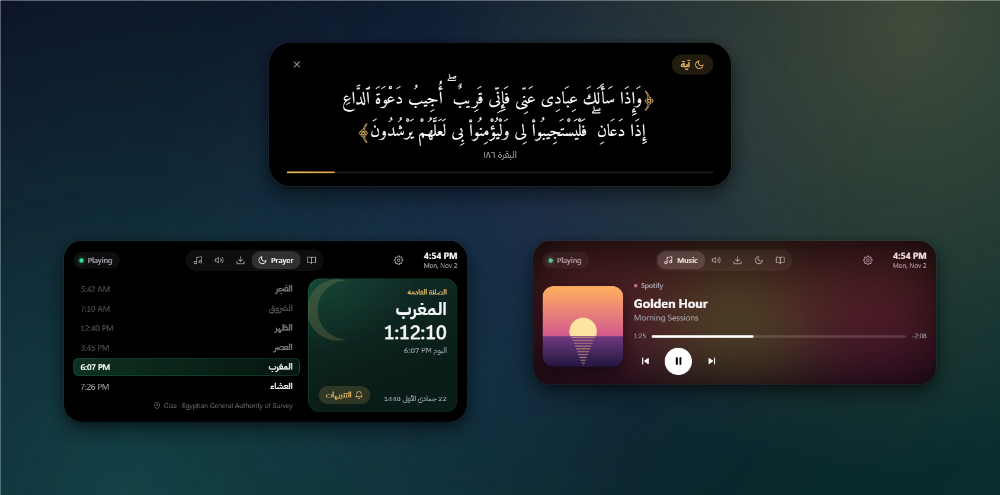

</div>

## ما هو هلال؟

يستقرّ «هلال» أعلى منتصف الشاشة على هيئة شريطٍ أسود صغير، مثل «الجزيرة الديناميكية» في آيفون. يعرض لك ما يهمّك في هذه اللحظة: الصلاة القادمة، أو الأغنية التي تسمعها، أو تحميلًا قيد التقدّم. انقر عليه فيتّسع ويصير لوحةً كاملة.

صُمّم للمسلم الذي يقضي يومه أمام حاسوبه. إذا دخل وقت الصلاة رفع هلال الأذان **وأوقف ما يعمل من موسيقى أو فيديو تلقائيًا**، فلا تفوتك الصلاة لأن السمّاعات على أذنيك.

<div align="center">
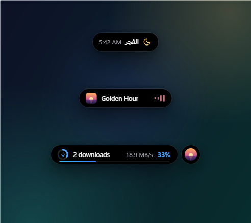
</div>

حين لا يحدث شيء تعرض الجزيرة الصلاة القادمة، وحين تعمل أغنية تعرضها، وحين تحمّل ملفًا تعرض تقدّمه. وإذا اجتمع أمران انتقل الثاني إلى فقاعةٍ صغيرة بجانبها.

## المزايا

### مواقيت الصلاة والأذان

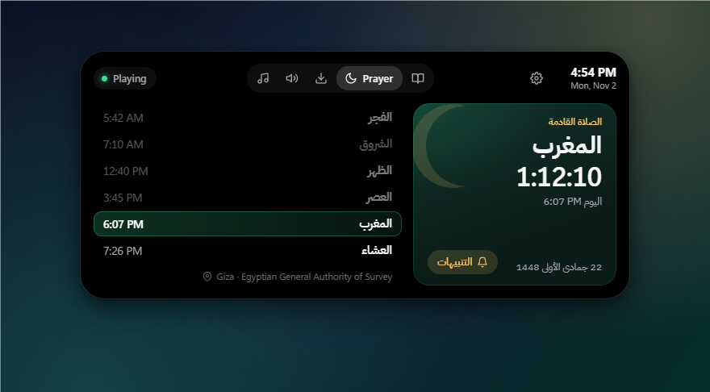

- مواقيت اليوم الستة مع عدٍّ تنازليٍّ حيّ للصلاة القادمة، والتاريخ الهجري.
- ١٨ طريقة حساب (الهيئة المصرية العامة للمساحة، وأم القرى، ورابطة العالم الإسلامي، وأمريكا الشمالية، وكراتشي، ودبي، والكويت، وقطر، وتركيا وغيرها) وأكثر من ١٠٠ مدينة، ويمكنك أيضًا ترك ويندوز يحدّد موقعك.
- العصر على قول الجمهور أو الحنفية، وتعديل التاريخ الهجري، وضبط كل صلاةٍ بالدقائق لتوافق مسجدك.
- تنبيهٌ قبل كل صلاة بدقائق مع عدٍّ تنازلي.
- عند دخول الوقت يرفع هلال الأذان (ثلاثة أصوات مرفقة، أو ملفك الخاص، مع إمكانية صوتٍ مختلف للفجر)، و**يوقف سبوتيفاي ويوتيوب وأي مشغّل وسائط**، ثم يعرض دعاء ما بعد الأذان.
- أما التطبيقات التي لا تقبل الإيقاف، كبعض الألعاب والمشغّلات، فيمكنه كتم صوتها حتى ينتهي الأذان.

<p>
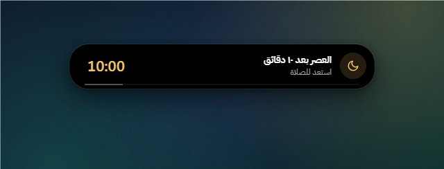
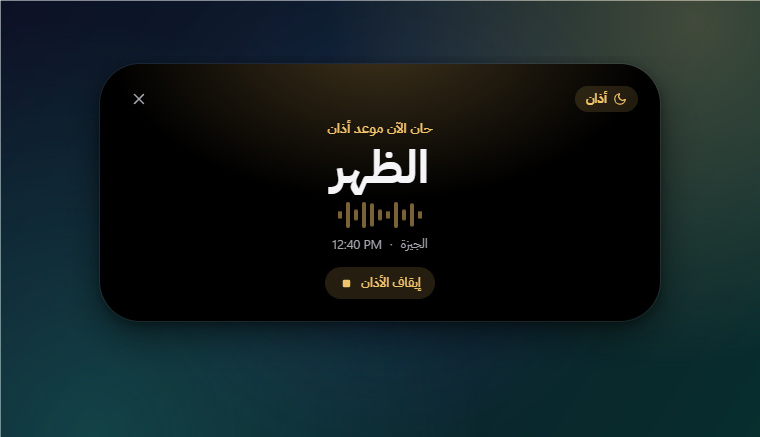
</p>

### آيات وأذكار

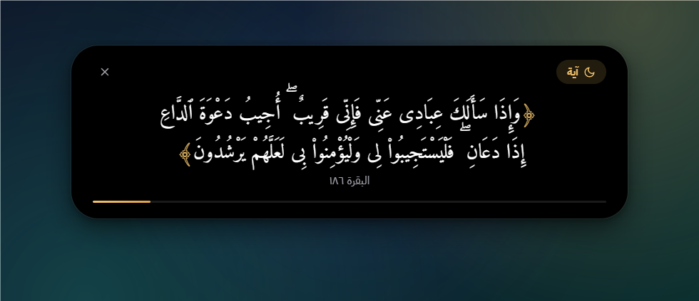

- كل ٥ دقائق (أو ١ أو ٢ أو ١٠ أو ١٥ أو ٣٠ أو ٦٠) تعرض الجزيرة آيةً أو ذِكرًا أو دعاءً. **ضع مؤشر الفأرة عليها فتبقى** حتى تُتمّ القراءة.
- ٨٠ آيةً مختارة في الذِّكر والدعاء والصبر والرحمة، بالرسم العثماني، منقولةً حرفيًا من [مشروع تنزيل](https://tanzil.net).
- ٣٤ ذِكرًا ودعاءً من السنة الصحيحة مع مصادرها: صحيح البخاري وصحيح مسلم وسنن الترمذي وأبي داود وابن ماجه.
- تهدأ حين تلعب أو تشاهد شيئًا بملء الشاشة، ويمكنك إيقافها ساعةً من أيقونة هلال بجانب الساعة.
- في تبويب الأذكار مسبحةٌ إلكترونية (٣٣ / ٣٣ / ٣٤).

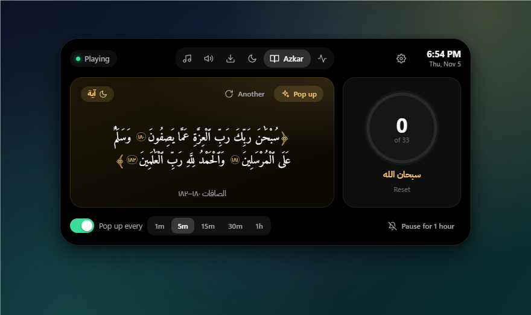

### الموسيقى

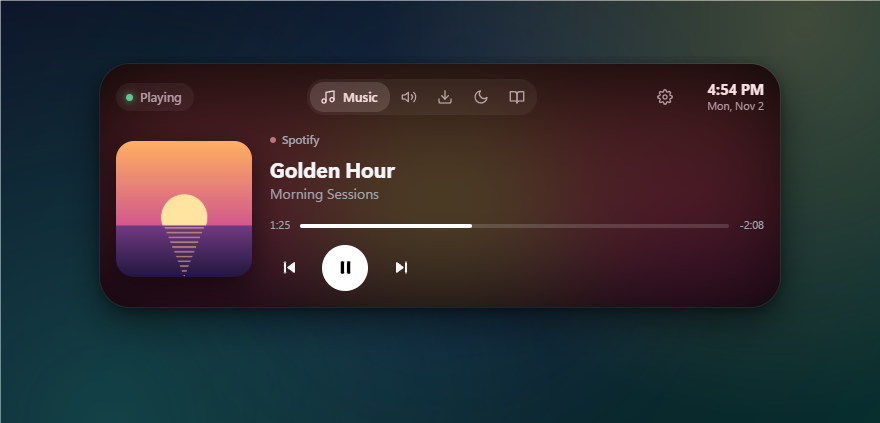

يعمل مع أي تطبيقٍ يستخدم أدوات التحكّم بالوسائط في ويندوز، مثل سبوتيفاي، ويوتيوب وغيره من المواقع في كروم أو إيدج أو فايرفوكس، ومشغّل وسائط ويندوز. تظهر لك صورة الألبوم وشريط التقدّم وأزرار التشغيل والإيقاف والتالي والسابق، وتتلوّن الواجهة بألوان غلاف الألبوم.

### الصوت والسطوع

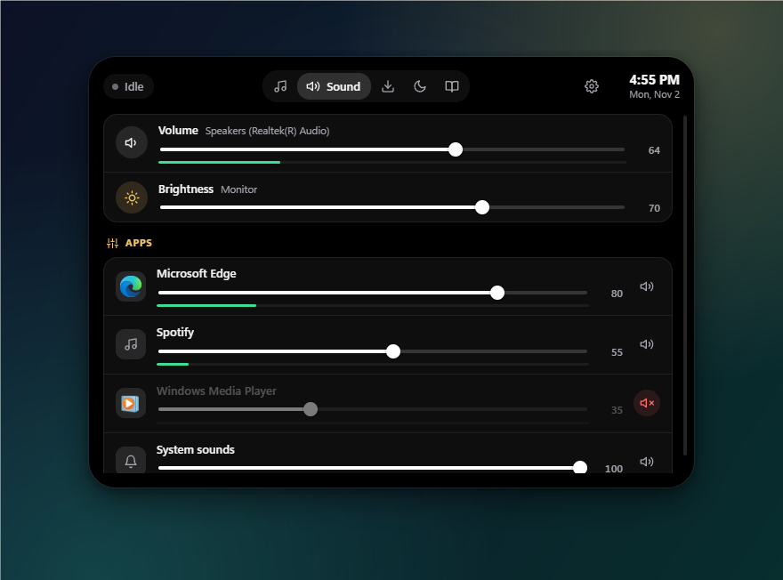

- **خلّاط صوتٍ داخل الجزيرة.** يعرض تبويب Sound (الصوت) مستوى صوت السمّاعات، وسطوع الشاشة، وكل تطبيقٍ يُصدر صوتًا، ولكلٍّ منها شريطه وزرّ كتمه ومؤشر مستواه الحي.
- **نافذة صوتٍ أجمل.** حين تضغط أزرار الصوت في لوحة المفاتيح تُظهر الجزيرة مستوى الصوت الجديد بدل نافذة ويندوز. وفي الألعاب والفيديو بملء الشاشة تعمل الأزرار كالمعتاد.
- **مرِّر عجلة الفأرة فوق الجزيرة** لتغيير الصوت، أو اضغط **Shift** أثناء التمرير لتغيير السطوع.
- يعمل التحكّم بالسطوع على شاشات اللابتوب ومعظم الشاشات الخارجية (عبر DDC/CI، وقد تحتاج بعض الشاشات إلى تفعيله من قائمتها).
- **اكتم الميكروفون في كل التطبيقات** بـ **Ctrl+Alt+K**، أو بأي اختصارٍ تختاره (الإعدادات ← Microphone ← Change ثم اضغط المفاتيح): ديسكورد والألعاب والمتصفح تصمت معًا. يبقى ميكروفونٌ أحمر على الجزيرة طوال الكتم، وفي زاوية الألعاب بملء الشاشة أيضًا، مع نغمةٍ قصيرة عند التغيير.

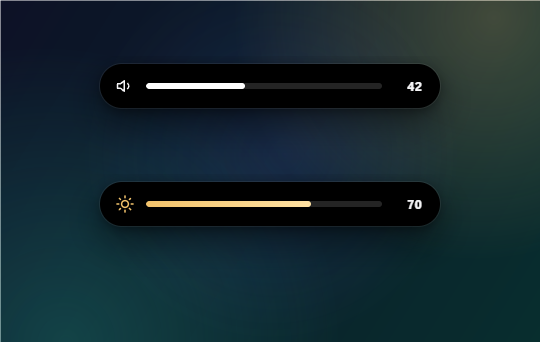

### مراقب النظام

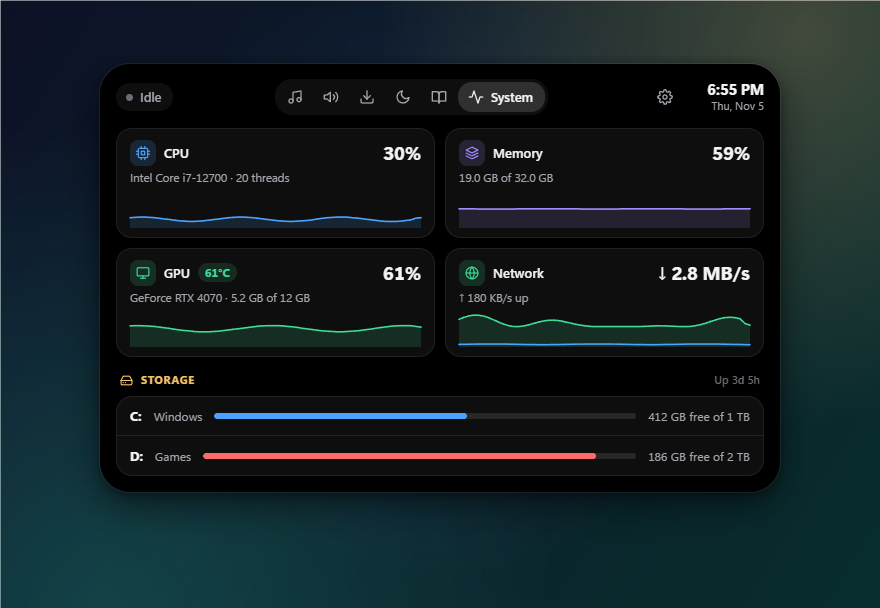

- **المعالج والذاكرة وكرت الشاشة والشبكة في لمحة**، ولكلٍّ منها رسمٌ لآخر دقيقة. ومع كرت NVIDIA ترى أيضًا حرارة كرت الشاشة وذاكرته.
- **المساحة الفارغة في كل قرص**، باللون الأحمر حين يقترب القرص من الامتلاء.
- فعّل من الإعدادات ← System ← **Show on the island** لتبقى نسبة استخدام المعالج وحرارة كرت الشاشة بجانب ما تعرضه الجزيرة.
- **عدّاد الإطارات (FPS).** في الألعاب بملء الشاشة يظهر عدّادٌ صغير في الزاوية التي تختارها بدل الجزيرة. يقرأ أحداث الإطارات من ويندوز نفسه كما يفعل Game Bar، فلا يلمس اللعبة وهو آمنٌ مع أنظمة مكافحة الغش. يطلب ويندوز موافقة المسؤول مرةً واحدة (الإعدادات ← System ← **Allow**) ثم تسجّل الخروج وتعود. يعمل مع ألعاب DirectX.
- **بطارية أجهزة البلوتوث.** حين تتصل سمّاعاتك أو يد التحكّم أو الفأرة تُظهر الجزيرة ذلك مع نسبة البطارية، وتنبّهك عند ٢٠٪ و١٠٪. ويعرض تبويب System أجهزة البلوتوث لديك. تظهر بطارية يد بلايستيشن عبر USB، أو عبر البلوتوث حين يكون Steam مفتوحًا.
- **وقت اللعب.** كم لعبت كل لعبةٍ اليوم وهذا الأسبوع، مع رسمٍ لآخر ٧ أيام في تبويب System. يحسب الألعاب التي يعرفها ويندوز (القائمة نفسها التي يستخدمها Game Bar) والألعاب في مجلدات Steam وEpic وغيرها، ما دامت مفتوحةً بملء الشاشة. الفيديو والمتصفح لا يُحسبان أبدًا.
- لا يأخذ القراءات إلا وأنت تنظر إليها (أو حين يكون ذلك الخيار مفعّلًا)، ولا يعمل أبدًا أثناء الألعاب بملء الشاشة.

### التحميلات

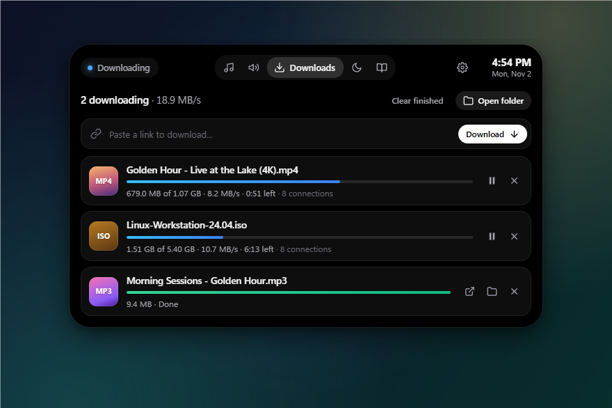

- الصق رابطًا، أو **انسخ رابط ملفٍّ من أي مكان** وسيعرض عليك هلال تحميله.
- حتى ١٦ اتصالًا للملف الواحد كما في مسرّعات التحميل، مع الإيقاف والاستئناف حتى بعد إعادة التشغيل.
- تظهر أيضًا التحميلات التي تبدؤها في كروم أو إيدج أو فايرفوكس، حين تُحفظ في مجلد التنزيلات.

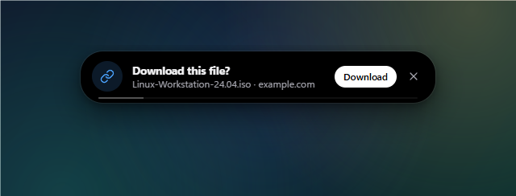

### الإعدادات

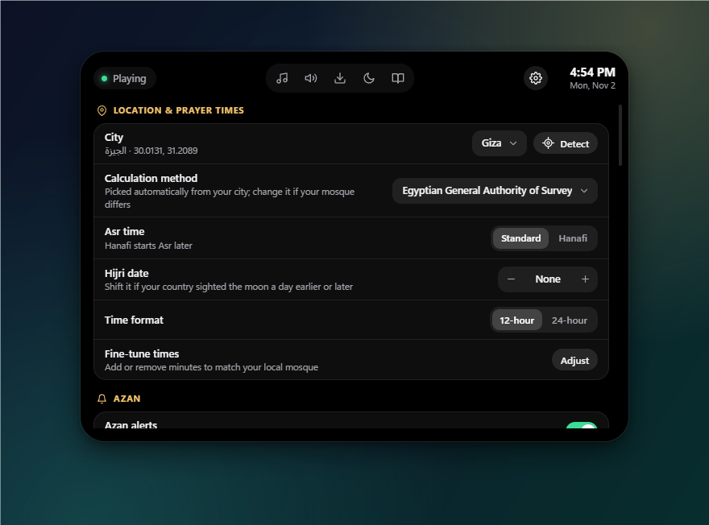

كل شيءٍ داخل الجزيرة نفسها (أيقونة الترس): الموقع وطريقة الحساب، وصوت الأذان وطوله وارتفاعه، والصلوات التي يُرفع لها الأذان، وتكرار التذكيرات، ومجلد التحميل، ونافذة الصوت، وموضع الجزيرة، والتشغيل مع ويندوز، وغير ذلك.

واجهة الإعدادات بالإنجليزية حاليًا، أما أسماء الصلوات والآيات والأذكار فبالعربية.

## التثبيت

1. نزّل ملف **`Hilal-Setup-….exe`** من [آخر إصدار](https://github.com/ahmad3a4/hilal-island/releases/latest). وللتحديث لاحقًا ثبّت الإصدار الجديد فوق القديم، وتبقى إعداداتك كما هي.
2. شغّله. المثبّت غير موقَّع رقميًا بعد، لذلك قد يُظهر ويندوز رسالة *«Windows protected your PC»*. اضغط **More info** ثم **Run anyway**.
3. اختر العربية أو الإنجليزية ومجلد التثبيت، وسيعمل هلال فور انتهاء التثبيت.

يتطلّب ويندوز ١٠ أو ١١ بنظام ٦٤ بت، ولا يحتاج صلاحيات المسؤول.

## أول الخطوات

1. انقر على الجزيرة، ثم أيقونة **الترس**، ثم **City** (المدينة). اختر مدينتك أو اضغط **Detect** (تحديد الموقع). تُضبط طريقة الحساب تلقائيًا حسب مدينتك، ويمكنك تغييرها.
2. اضغط **Test azan** (تجربة الأذان) لتسمعه، واختر الصوت الذي يعجبك.
3. انقر بزر الفأرة الأيمن على أيقونة هلال بجانب الساعة، وفعّل **Start with Windows** (التشغيل مع ويندوز).

- **لفتح اللوحة:** انقر على الجزيرة.
- **لإغلاقها:** أبعِد الفأرة عنها، أو اضغط Esc.
- **لتحريكها لأعلى أو لأسفل:** اسحب الجزيرة، ويُعيدها زر Reset من الإعدادات ← *Position*، ويثبّتها خيار *Lock position* في مكانها.
- **لتغيير الصوت:** مرِّر العجلة فوق الجزيرة (مع Shift للسطوع)، أو استخدم أزرار الصوت.
- **لكتم الميكروفون:** Ctrl+Alt+K، أو من أيقونة هلال.
- **لإيقاف التذكيرات مؤقتًا:** أيقونة هلال ← *Pause reminders for 1 hour*.
- **لإيقاف الأذان:** زر **إيقاف الأذان**، أو من أيقونة هلال.
- **لإخفاء الجزيرة:** أيقونة هلال ← *Hide the island*.

## الخصوصية

يعمل هلال دون إنترنت. لا حساب ولا إعلانات ولا تتبّع، ولا يرسل شيئًا إلى أي جهة. تُحسب مواقيت الصلاة على جهازك، ولا يُستخدم الإنترنت إلا لتحميل الملفات التي تختارها أنت، ومرةً في اليوم لسؤال GitHub عن وجود إصدارٍ جديد (يمكنك إيقاف ذلك من الإعدادات، والتحديث من هناك بضغطة واحدة)، أما تحديد الموقع فيستخدم خدمة الموقع في ويندوز نفسه ويبقى على جهازك. تُحفظ إعداداتك في `%APPDATA%\Hilal`.

## البناء من المصدر

تحتاج ويندوز و[Node.js](https://nodejs.org) الإصدار 20 أو أحدث، ولا تحتاج Visual Studio ولا ‎.NET SDK.

```bash
git clone https://github.com/ahmad3a4/hilal-island.git
cd hilal-island
npm install      # downloads Electron and builds the native helper
npm start        # run Hilal
npm run dist     # build the installer into dist/
```

أوامر أخرى: ‏`npm run test:prayer` يقارن المواقيت بخدمة Aladhan، و`npm run test:downloads` يختبر محمّل الملفات على خادم محلي يحاكي المواقع الصعبة، و`npm run fetch:ayat` يعيد تنزيل الآيات من تنزيل، و`scripts/screenshots.ps1` يعيد التقاط الصور في هذا الملف.

## كيف يعمل

```
src/main/        Electron main process
  main.js          window, tray, the azan sequence, wiring
  prayer.js        prayer-time astronomy (matches Aladhan within a minute)
  scheduler.js     azan and heads-up timers, verse/dhikr rotation
  downloads.js     multi-connection downloader + browser download watcher
  settings.js      settings, saved in %APPDATA%\Hilal
src/renderer/    the island itself (HTML, CSS, JavaScript)
native/          HilalHelper.cs: media, per-app volume, brightness, GPU and network, fullscreen
assets/          fonts, azan recordings, verses, azkar, icon
```

المساعد الأصلي (HilalHelper) برنامجٌ صغير بلغة C# يقرأ جلسات الوسائط في ويندوز ويتحكّم بها، ويضبط صوت كل تطبيقٍ وسطوع الشاشة، ويقرأ حالة كرت الشاشة والشبكة، ويكتشف التطبيقات المفتوحة بملء الشاشة. يُبنى بمترجم C# المضمَّن في كل نسخةٍ من ويندوز، فلا يحتاج البناء إلى شيءٍ سوى Node.js.

## حلّ المشكلات

- **لم تتوقّف الموسيقى عند الأذان.** هذا التطبيق لا يدعم أدوات التحكّم بالوسائط في ويندوز. فعّل *Mute other apps too* (كتم التطبيقات الأخرى) من الإعدادات ← Azan.
- **تختلف المواقيت عن مسجدي بدقيقةٍ أو اثنتين.** استخدم *Fine-tune times* (ضبط المواقيت) من الإعدادات.
- **زر Detect لا يجد موقعي.** فعّل الموقع من إعدادات ويندوز: «الخصوصية والأمان» ← «الموقع»، بما في ذلك السماح لتطبيقات سطح المكتب بالوصول إلى موقعك، أو اختر مدينتك يدويًا.
- **لا يظهر شريط السطوع في تبويب الصوت.** شاشتك لا تستجيب لطلبات السطوع. فعّل *DDC/CI* من قائمة الشاشة نفسها، ثم أعد تشغيل هلال.
- **لم تستجب الجزيرة للنقر.** يسجّل الملف `%APPDATA%\Hilal\activity.log` ما فعلته الجزيرة (تطبيقات ملء الشاشة، والإخفاء والإظهار، والنقرات). أرفقه مع البلاغ.
- **مشكلةٌ أخرى؟** تُسجَّل الأخطاء في `%APPDATA%\Hilal\error.log`. [افتح بلاغًا](https://github.com/ahmad3a4/hilal-island/issues) وأرفق هذا الملف.

## الشكر والمصادر

- **نص القرآن الكريم:** [مشروع تنزيل](https://tanzil.net) بالرسم العثماني، منقولٌ حرفيًا وفق شروطه (نص الإشعار داخل `assets/data/ayat.json`).
- **الأذكار والأدعية:** من دواوين السنة الصحيحة، ومصدر كلٍّ منها مكتوبٌ تحتها.
- **الخطوط:** [Amiri Quran](https://github.com/aliftype/amiri) و[IBM Plex Sans Arabic](https://github.com/IBM/plex) برخصة SIL Open Font License.
- **تسجيلات الأذان:** من ويكيميديا كومنز برخصتي CC0 وCC BY-SA 4.0، والتفاصيل في [`assets/audio/CREDITS.md`](assets/audio/CREDITS.md).
- **حساب المواقيت:** المعادلات الفلكية المعتمدة، كما في PrayTimes.org ومكتبات Adhan.

## الرخصة

الكود منشورٌ برخصة [MIT](LICENSE). أما المحتوى المرفق (نص القرآن والخطوط والتسجيلات) فلكلٍّ منه رخصته الخاصة المذكورة أعلاه وفي ملف `LICENSE`.

<div align="center">
<sub>صُنع بعنايةٍ لكل من يحبّ أن يذكر الله وهو يعمل.</sub>
</div>
