<div align="center">


# Hilal

**A Dynamic Island for Windows.**<br>
Your music, a volume mixer, a system monitor, your downloads, prayer times with the azan, and a verse or dhikr every few minutes, all in one small pill at the top of your screen.

[**Download for Windows**](https://github.com/ahmad3a4/hilal-island/releases/latest) &nbsp;·&nbsp; [العربية](README.ar.md)

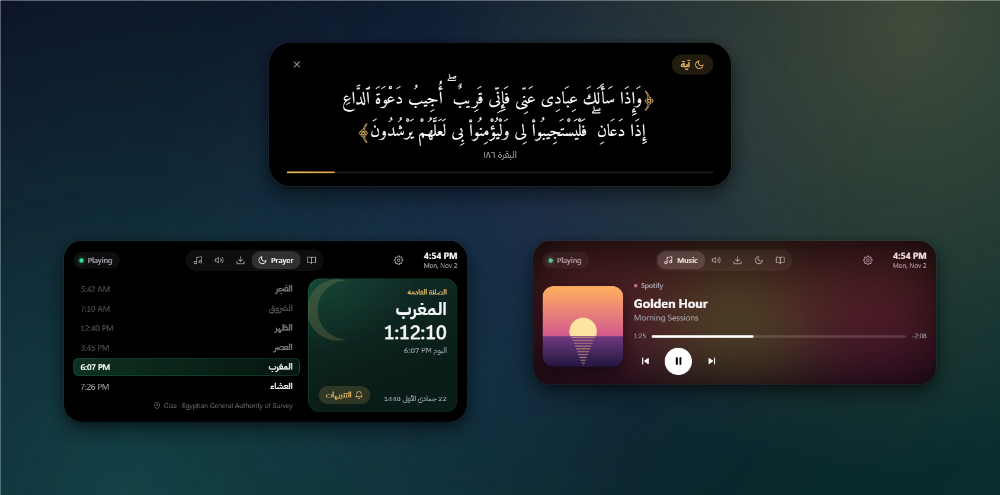

</div>

## What is Hilal?

Hilal (هلال, "crescent moon") sits at the top-center of your screen as a small black pill, like the Dynamic Island on the iPhone. It shows what matters right now: the next prayer, the song that's playing, a download in progress. Click it and it opens into a full panel.

It was made for Muslims who spend their day at a Windows PC. When the azan time comes, Hilal plays the azan and **pauses whatever music or video is playing**, so you never miss a prayer because your headphones were on.

<div align="center">
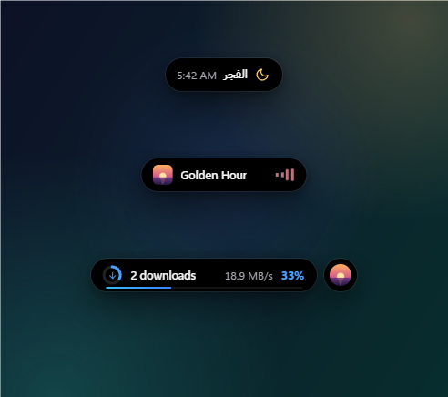
</div>

When nothing is happening, the island shows the next prayer. When a song plays it shows the song, and when you download something it shows the progress. If two things happen at once, the second one moves into a small bubble next to it.

## Features

### Prayer times and the azan

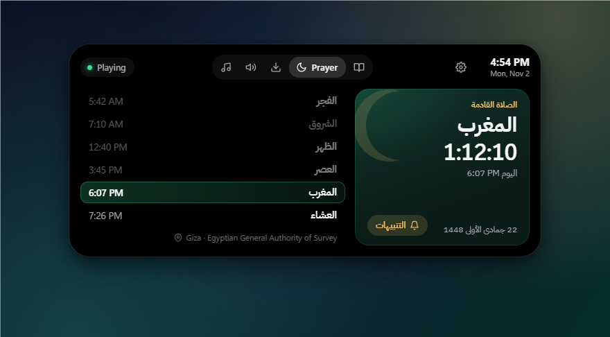

- Today's six times with a live countdown to the next prayer, plus the Hijri date.
- 18 calculation methods (Egyptian, Umm al-Qura, Muslim World League, ISNA, Karachi, Dubai, Kuwait, Qatar, Turkey and more) and over 100 cities. You can also let Windows detect your location.
- Asr by the standard method or Hanafi, a Hijri date adjustment, and per-prayer fine-tuning to match your local mosque.
- A heads-up a few minutes before each prayer, with a countdown.
- At prayer time Hilal plays the azan (three voices included, or use your own file, with a separate voice for Fajr if you like), **pauses Spotify, YouTube and any other media app**, and afterwards shows the du'a after the azan.
- For apps that can't be paused, such as some games and players, it can mute them until the azan ends.

<p>
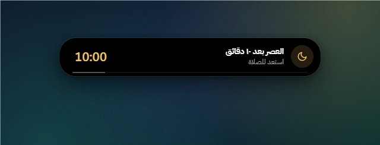
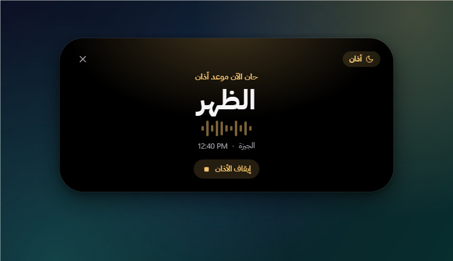
</p>

### Ayat and azkar

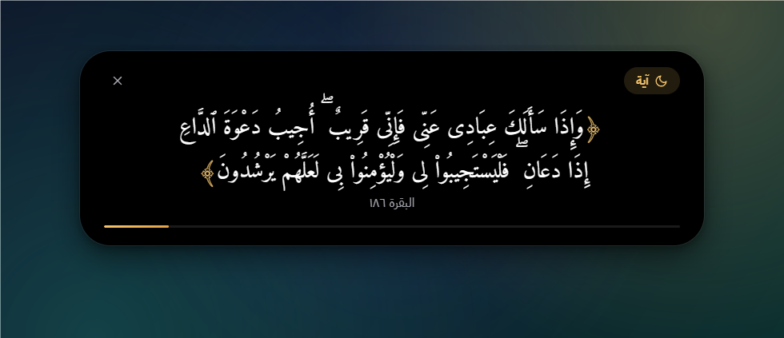

- Every 5 minutes (or 1, 2, 10, 15, 30 or 60) the island shows a Quran verse, a dhikr or a du'a. **Hover over it and it stays** until you finish reading.
- 80 hand-picked verses about remembrance, du'a, patience and mercy, in the Uthmani script, copied verbatim from the [Tanzil project](https://tanzil.net).
- 34 authentic azkar and du'a with their sources, from Sahih al-Bukhari, Sahih Muslim, at-Tirmidhi, Abu Dawud and Ibn Majah.
- It stays quiet while you play or watch something in fullscreen, and you can pause it for an hour from the tray.
- The Azkar tab has a tasbih counter (33 / 33 / 34).

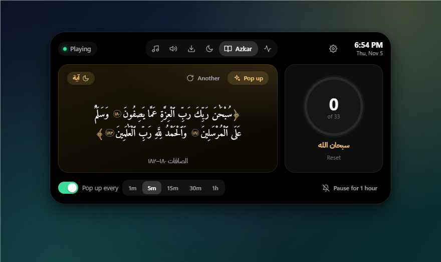

### Music

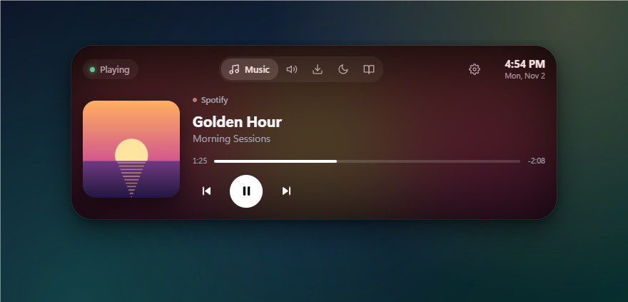

Works with any app that uses the Windows media controls, such as Spotify, YouTube and other sites in Chrome, Edge or Firefox, and Windows Media Player. You get the album art, the progress bar and play/pause/next/previous controls. The colors follow the album cover.

### Sound and brightness

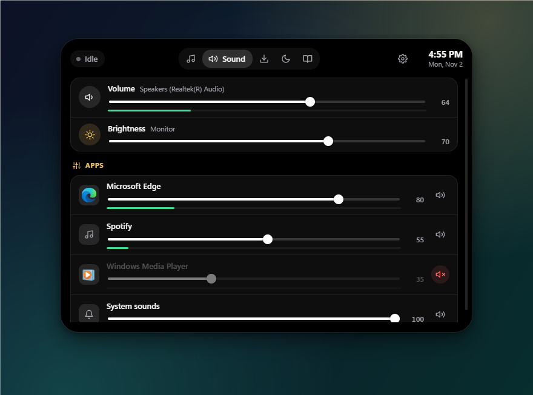

- **A volume mixer on the island.** The Sound tab shows the volume of your speakers or headphones, your screen's brightness, and every app that plays sound, each with its own slider, mute button and live level.
- **A nicer volume pop-up.** Press the volume keys and the island shows the new volume instead of the Windows pop-up. In fullscreen games and videos the keys work as usual.
- **Scroll on the island** to change the volume, or hold **Shift** while scrolling to change the brightness.
- Brightness works on laptop screens and on most external monitors (through DDC/CI, which some monitors have to switch on in their own menu).
- **Mute your microphone everywhere** with **Ctrl+Alt+K**, or any key combination you choose (Settings → Microphone → Change, then press your keys): Discord, games and browsers all go quiet at once. A red mic stays on the island while you're muted, also in the corner of fullscreen games, with a short tone when it changes.

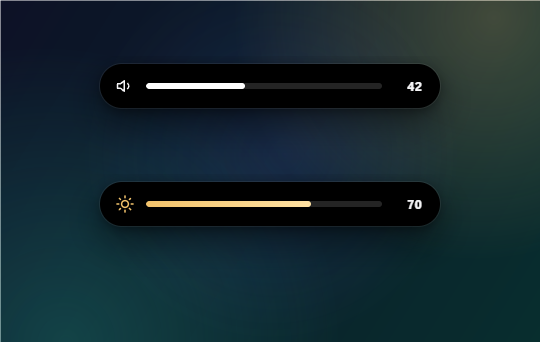

### System monitor

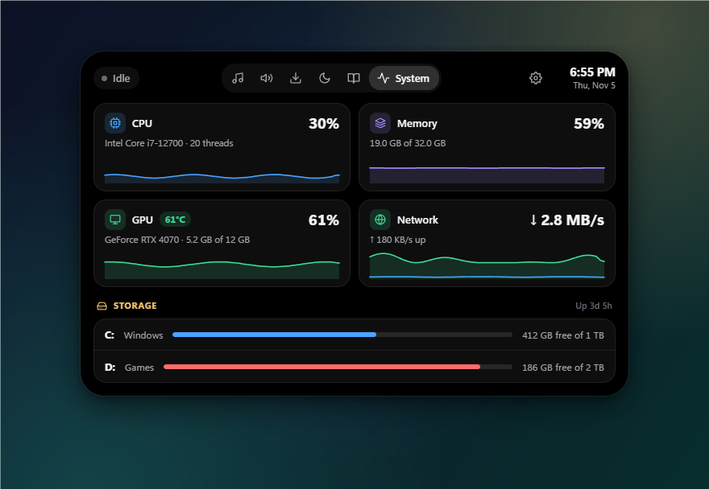

- **CPU, memory, GPU and network at a glance**, each with a graph of the last minute. With an NVIDIA card you also see the GPU temperature and video memory.
- **Free space on every drive**, in red when a drive is almost full.
- Turn on Settings → System → **Show on the island** to keep CPU use and GPU temperature next to whatever the island is showing.
- **FPS counter.** In fullscreen games, a small FPS counter appears in the corner you choose instead of the island. It reads Windows' own frame events, like Game Bar does, so nothing touches the game and it's safe with anti-cheat. Windows asks for an administrator's OK once (Settings → System → **Allow**), then you sign out and back in. Works with DirectX games.
- **Bluetooth battery.** When your headphones, controller or mouse connect, the island shows it with the battery level, and it warns you at 20% and 10%. The System tab lists your Bluetooth devices. PlayStation controllers show their battery over USB, or over Bluetooth while Steam is running.
- **Play time.** How long you played each game today and this week, with a 7-day chart in the System tab. It counts the games Windows knows (the same list Game Bar uses) and games in Steam, Epic and other game folders, while they're open in fullscreen. Videos and browsers never count.
- It only takes readings while you're looking (or while that readout is on), and never during fullscreen games.

### Downloads

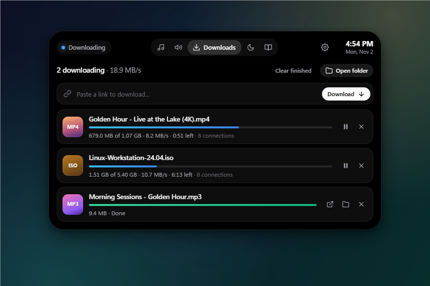

- Paste a link, or **copy a link to a file anywhere** and Hilal offers to download it.
- Up to 16 connections per file, like a download accelerator. Downloads pause and resume, even after a restart.
- Downloads you start in Chrome, Edge or Firefox show up too, when they're saved to your Downloads folder.

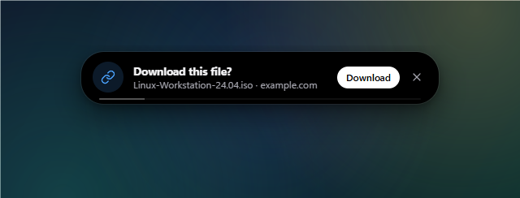

### Settings

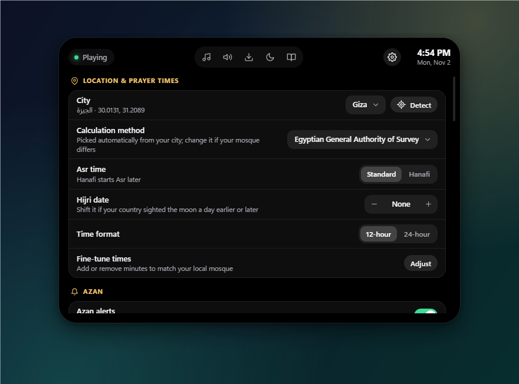

Everything is in the island itself (the gear icon): location and calculation method, azan voice, length and volume, which prayers have an azan, how often reminders appear, the download folder, the volume pop-up, the island's position, start with Windows, and more.

The interface is in English. Prayer names, verses and azkar are in Arabic.

## Install

1. Download **`Hilal-Setup-….exe`** from the [latest release](https://github.com/ahmad3a4/hilal-island/releases/latest). To update later, just install the new version over the old one; your settings stay.
2. Run it. The installer isn't code-signed yet, so Windows may show *"Windows protected your PC"*. Click **More info**, then **Run anyway**.
3. Pick English or Arabic and a folder. Hilal starts when the installer finishes.

Requires Windows 10 or 11, 64-bit. No admin rights needed.

## First steps

1. Click the island, then the **gear** icon, then **City**. Pick your city or press **Detect**. The calculation method is set from your city, and you can change it.
2. Press **Test azan** to hear it, and choose a voice you like.
3. Right-click the tray icon (near the clock) and turn on **Start with Windows**.

| You want to | Do this |
|---|---|
| Open the panel | Click the island |
| Close it | Move the mouse away, or press Esc |
| Move it up or down | Drag the island. Settings → *Position* puts it back, and *Lock position* keeps it in place |
| Change the volume | Scroll on the island (hold Shift for brightness), or use the volume keys |
| Mute your microphone | Ctrl+Alt+K, or the tray icon |
| Pause the pop-ups for a while | Tray icon → *Pause reminders for 1 hour* |
| Stop the azan | The **إيقاف الأذان** button, or the tray icon |
| Hide the island | Tray icon → *Hide the island* |

## Privacy

Hilal works offline. It has no account, no ads, no analytics, and it sends nothing anywhere. Prayer times are calculated on your PC. The internet is used only for files you choose to download, and once a day to ask GitHub whether there is a new version (you can turn that off in Settings, and update from there with one click), and location detection uses Windows' own location service, which stays on your device. Your settings live in `%APPDATA%\Hilal`.

## Build from source

You need Windows and [Node.js](https://nodejs.org) 20 or newer. Visual Studio and the .NET SDK are *not* needed.

```bash
git clone https://github.com/ahmad3a4/hilal-island.git
cd hilal-island
npm install      # also downloads Electron and builds the native helper
npm start        # run Hilal
npm run dist     # build the installer into dist/
```

Other scripts: `npm run test:prayer` compares the prayer times with the Aladhan API, `npm run test:downloads` checks the downloader against a local server that imitates difficult hosts, `npm run fetch:ayat` re-downloads the verses from Tanzil, and `scripts/screenshots.ps1` retakes the screenshots in this README.

## How it works

```
src/main/        Electron main process
  main.js          window, tray, the azan sequence, wiring
  prayer.js        prayer-time astronomy (matches Aladhan within a minute)
  scheduler.js     azan and heads-up timers, verse/dhikr rotation
  downloads.js     multi-connection downloader + browser download watcher
  settings.js      settings, saved in %APPDATA%\Hilal
src/renderer/    the island itself (HTML, CSS, JavaScript)
native/          HilalHelper.cs, a small C# program that reads and controls
                 Windows media sessions, the volume of each app and the screen
                 brightness, reads the GPU and network, and detects fullscreen apps
assets/          fonts, azan recordings, verses, azkar, icon
```

The native helper is compiled with the C# compiler that ships with every copy of Windows (`csc.exe` from .NET Framework 4), so building needs nothing beyond Node.js.

## Troubleshooting

- **The music didn't pause at azan time.** That app doesn't support the Windows media controls. Turn on *Mute other apps too* in Settings → Azan.
- **The times differ from my mosque by a minute or two.** Use Settings → *Fine-tune times*.
- **Detect doesn't find my location.** Turn on *Settings → Privacy & security → Location* in Windows, including *Let desktop apps access your location*, or just pick your city.
- **There's no Brightness slider in the Sound tab.** Your monitor doesn't answer brightness requests. Turn on *DDC/CI* in the monitor's own on-screen menu, then restart Hilal.
- **The island didn't react to a click.** `%APPDATA%\Hilal\activity.log` records what the island did (fullscreen apps, hiding and showing, clicks). Attach it to an issue.
- **Something else.** Errors are written to `%APPDATA%\Hilal\error.log`. Please [open an issue](https://github.com/ahmad3a4/hilal-island/issues) and attach it.

## Credits

- **Quran text:** [Tanzil Project](https://tanzil.net), Uthmani text, used verbatim under its terms (the notice is inside `assets/data/ayat.json`).
- **Azkar and du'a:** from the authentic Sunnah collections. The source is shown under each one.
- **Fonts:** [Amiri Quran](https://github.com/aliftype/amiri) and [IBM Plex Sans Arabic](https://github.com/IBM/plex), SIL Open Font License.
- **Azan recordings:** Wikimedia Commons, CC0 and CC BY-SA 4.0. See [`assets/audio/CREDITS.md`](assets/audio/CREDITS.md).
- **Prayer-time math:** the standard astronomical formulas, as used by PrayTimes.org and the Adhan libraries.

## License

The code is released under the [MIT License](LICENSE). The bundled content (Quran text, fonts, recordings) keeps its own license, listed above and in `LICENSE`.

<div align="center">
<sub>Made with care for everyone who wants to remember Allah while they work.</sub>
</div>
